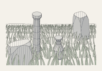
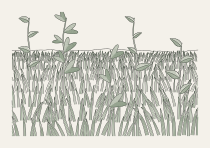
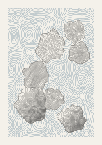
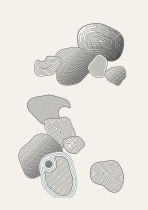
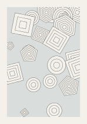
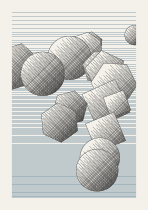

# wtc-drawer

A vector generative art library for **pen plotters**. You draw on a sheet of
paper measured in millimetres, each layer is a pen, and the output is an SVG
an AxiDraw can plot as it is: no stray fills, hidden lines removed, paths
ordered to keep the pen-up travel short.

It covers the parts of a plotter drawing that are fiddly to do well:
occlusion (shapes in front hide what's behind them), hatching and tone,
outline-following contour fills, flow fields, swept shapes like grass and
leaves, small 3D objects with exact hidden lines, and plot optimisation.

| | |
| :-: | :-: |
| [](https://github.com/liamegan/Drawer/blob/main/playground/sketches/stones.ts) | [](https://github.com/liamegan/Drawer/blob/main/playground/sketches/meadow.ts) |

| | | | |
| :-: | :-: | :-: | :-: |
| [](https://github.com/liamegan/Drawer/blob/main/playground/sketches/flow.ts) | [](https://github.com/liamegan/Drawer/blob/main/playground/sketches/contours.ts) | [](https://github.com/liamegan/Drawer/blob/main/playground/sketches/occlusion.ts) | [](https://github.com/liamegan/Drawer/blob/main/playground/sketches/shading.ts) |

Each picture links to the sketch that made it. They're the plotter SVGs
themselves, with the paper colour filled in.

**API reference:** [liamegan.github.io/Drawer](https://liamegan.github.io/Drawer/)

## Status

`wtc-drawer` isn't on npm yet. To try it, clone this repository and run the
playground (below), or add your own sketch to `playground/sketches/`.

The library depends on [`wtc-math`](https://www.npmjs.com/package/wtc-math)
for `Vec2`, `Vec3` and the matrices, as a peer dependency: you install it
alongside and use the same `Vec2` the library does.

## Quick start

```ts
import { Vec2 } from "wtc-math";
import { Random, Sheet, circle, paper, rect, toSVG } from "wtc-drawer";

const sheet = new Sheet({ paper: paper.A5, margin: 12 });
const random = new Random("my seed");

const ink = sheet.layer("ink", { color: "#1b1b1b", width: 0.3 });
const red = sheet.layer("red", { color: "#c8432b", width: 0.5 });

const area = sheet.drawArea;
for (let i = 0; i < 40; i++) {
  const p = random.pointIn(area);
  if (random.bool(0.7)) ink.add(rect(p.x - 4, p.y - 4, 8, 8));
  else red.add(circle(new Vec2(p.x, p.y), random.range(2, 6)));
}

const svg = toSVG(sheet); // one Inkscape layer per pen
```

Everything is in millimetres, with the origin at the top-left and y pointing
down. All randomness goes through `Random`, so a seed always gives the same
drawing; `random.fork("label")` makes an independent stream, so adding draws
in one part of a sketch doesn't change another.

## Concepts

### Occlusion

Draw **front to back**. `sheet.draw()` clips paths against what's already on
the sheet and then stamps their silhouette into a mask, so later paths are
hidden behind them. `layer.add()` (or `sheet.add()`) skips both.

```ts
import { Vec2 } from "wtc-math";
import { Sheet, circle, paper, rect } from "wtc-drawer";

const sheet = new Sheet({ paper: paper.A6, occlusion: { gap: 0.3 } });
sheet.layer("ink");
sheet.draw("ink", circle(new Vec2(50, 60), 20)); // in front
sheet.draw("ink", rect(40, 40, 50, 50)); // behind: clipped by the circle
```

`gap` keeps lines behind a shape a little way off its outline, so the pen
doesn't bleed over it.

### Hatching and tone

`hatch` fills a shape with parallel lines; `shade` builds a tone from 0
(paper) to 1 (solid) out of passes at several angles, spaced for the pen's
width. Lines are pinned to a page-wide lattice, so neighbouring shapes
hatched alike line up.

```ts
import { Vec2 } from "wtc-math";
import { Sheet, circle, hatch, paper, shade } from "wtc-drawer";

const sheet = new Sheet({ paper: paper.A6 });
const ball = circle(new Vec2(52, 74), 30);
sheet.layer("ink");
sheet.layer("shade", { width: 0.25 });

sheet.draw("ink", ball, { silhouette: false });
sheet.draw("shade", shade(ball, { tone: 0.4, pen: 0.25 }), {
  silhouette: ball,
});
const lines = hatch(ball, { spacing: 1, angle: Math.PI / 4 });
```

Outline and hatch go on separate pens: draw the outline without stamping the
mask, then the hatch with the outline as its silhouette.

### Distance fields and contours

`sdf(shapes)` makes a signed distance field (negative inside, in mm).
`contourHatch` fills a shape with rings that follow its outline inwards, and
`contourSpiral` does the same as one continuous line per lobe.

```ts
import { Vec2 } from "wtc-math";
import { circle, contourHatch, contourSpiral, sdf } from "wtc-drawer";

const blob = sdf([circle(new Vec2(40, 50), 20), circle(new Vec2(65, 50), 15)]);
const rings = contourHatch(blob, { spacing: 1.2 });
const spiral = contourSpiral(blob, { spacing: 1.2 });
```

### Flow fields

`Noise` gives seeded simplex noise and fBm; `angleField` and `curlField` turn
it into a vector field; `flowHatch` fills a shape with long, evenly spaced
streamlines.

```ts
import { Vec2 } from "wtc-math";
import { Noise, Random, circle, curlField, flowHatch } from "wtc-drawer";

const noise = new Noise(new Random("flow").fork("noise"));
const field = curlField((x, y) => noise.fbm2(x * 0.02, y * 0.02));
const lines = flowHatch(circle(new Vec2(52, 74), 40), {
  field,
  spacing: 1.5,
});
```

### Sweeps

A `Sweep` carries a width profile along a curved spine: blades of grass,
leaves, petals and stems. `sweepHatch` hatches it across or along its own
length, so the lines follow its form.

```ts
import { Vec2 } from "wtc-math";
import { Sweep, catmullRom, profiles, sweepHatch } from "wtc-drawer";

const spine = catmullRom([
  new Vec2(50, 140),
  new Vec2(46, 100),
  new Vec2(58, 70),
]);
const blade = new Sweep(spine, { width: 6, profile: profiles.blade() });
const lines = sweepHatch(blade, { direction: "along", tone: 0.5, pen: 0.3 });
// Draw blade.openOutline, with blade.outline as its silhouette.
```

### 3D objects

Meshes are built in a y-up world (`box`, `lathe`, `extrude`,
`breakCorners` for weathered stone) and turned into 2D lines by
`renderMesh`, which removes hidden lines exactly and hatches each face by
its lighting, with the lines painted on the face.

```ts
import { Vec2, Vec3 } from "wtc-math";
import {
  Random,
  box,
  breakCorners,
  orthographic,
  renderMesh,
} from "wtc-drawer";

const stone = breakCorners(box(new Vec3(30, 40, 20)), new Random("stone"));
const drawing = renderMesh(stone, {
  projection: orthographic(),
  at: new Vec2(74, 100),
  pen: 0.3,
});
// drawing.edges, drawing.creases and drawing.hatch are Polyline[];
// drawing.silhouette goes in the mask.
```

### Plot optimisation

`optimize(sheet)` returns a copy ready to plot: duplicate strokes removed,
touching paths joined and each pen's paths ordered to shorten pen-up travel.
`plotStats` estimates the distance and the time.

```ts
import { Sheet, optimize, plotStats, toSVG } from "wtc-drawer";

const sheet = new Sheet();
// ...draw...
const plotted = optimize(sheet);
console.log(plotStats(plotted).seconds);
const svg = toSVG(plotted);
```

## Playground

```sh
npm install
npm run dev   # then open /?sketch=stones
```

The playground previews a sketch from `playground/sketches/` at a seed, with
a side panel for the sketch's parameters, its traits and export.

- `s` saves the SVG (optimised), `p` a PNG at print resolution.
- `r` picks a new seed and `←` / `→` step through them.
- `o` shows the raw drawing, `t` the pen-up travel, `m` the occlusion mask
  and `d` the sketch's debug guides.
- **Export range** writes a whole run of seeds to `exports/<sketch>/`, with a
  `traits.json` tallying each seed's traits.

A sketch is a module that default-exports `defineSketch({ title, paper,
params, draw })`; see `playground/sketches/stones.ts` for a full one and
`playground/Sketch.ts` for the contract.

## Development

```sh
npm test            # Vitest
npm run typecheck
npm run build       # dist/: ES module and .d.ts files
npm run docs        # API docs into docs/api/
npm run gallery     # re-renders docs/gallery/
```

[`roadmap.md`](https://github.com/liamegan/Drawer/blob/main/roadmap.md) lists what's built and what's next, and
[`CLAUDE.md`](https://github.com/liamegan/Drawer/blob/main/CLAUDE.md) the conventions the code follows.

## License

MIT
